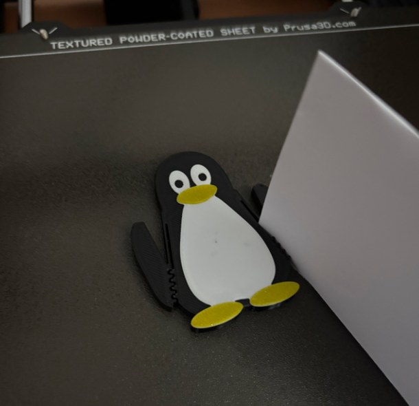
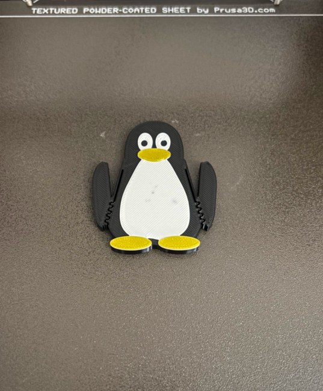

# Tux Clip and Tux Vise 🐧

Two entries for the Printables contest **[Designer Challenge: Vises](https://www.printables.com/contest/534-vises)**.



*Tux Clip M, printed on a Prusa MK4 in Prusament PETG (black, white and Yellow Gold), holds a sheet of paper.*

Both models are Tux, the Linux penguin. They print without supports, need no screws, springs or other hardware, and get their colours from filament changes (M600) on a single-extruder printer.

The models are fully parametric. They are written in Python with [build123d](https://github.com/gumyr/build123d), and both share one code base.

## Tux Clip

A small clip shaped like Tux. **Squeeze his shoulders and his flippers open.** Let go and they close on whatever you put under them: a note, a photo, a ticket, a cable, the top of a bag.

It is one piece, printed in place: no assembly, nothing to snap in. It comes in three sizes, plus a desk version that holds a card upright, and a small coupon to feel the stiffness of the flexure.



*Tux Clip M straight off the textured sheet, at rest: the comb teeth of the flippers mesh with the body.*


### How it works

- **Flexure.** Each flipper hangs on a thin, flexible wall (a leaf, 2 lines wide). When you squeeze the shoulder, the leaf bends and the flipper swings out around it, like a seesaw.
- **Comb jaws.** The inside of each flipper and the side of the body have teeth that mesh like a comb. At rest the tips of the teeth reach **1 mm past each other**, without touching. So the jaw is already "closed past zero": a thin card must push the flipper open by its own thickness plus that millimetre, and the flexure presses back. Paper and thin plastic are held because they have to wave through the teeth.
- **Stop.** The top of the flipper meets the shoulder after a fixed swing. You cannot bend the leaf further than that, however hard you squeeze, and neither can a thick object pushed into the jaw. At the stop, the most bent point of the leaf is stretched by 2.55 %: half of the 5.1 % at which PETG yields. So it does not tire.
- **Printed on its back.** The leaf is a vertical wall, so it bends along its extrusion lines, never across the layers. That is the strong direction of a 3D print.

| Size | Tux height | Jaw opening | Swing | Leaf length | Grip on a 1 mm card* |
|---|---|---|---|---|---|
| S | 50 mm | 4 mm | 19° | 9.8 mm | 0.31 N |
| M | 65 mm | 8 mm | 29° | 15.4 mm | 0.12 N |
| L | 75 mm | 11 mm | 34° | 18.7 mm | 0.08 N |

\* Calculated at the flipper tip, with a 2-line leaf. The grip is about twice as strong halfway up the jaw, and grows with the thickness of what you clamp. The jaw opening is what a squeeze gives you. Something thicker can still be pushed in from the side, up to 6 / 12 / 17 mm, before the stop. **Tux Clip is a gentle clip**: it holds notes, photos, tickets and cables, not a heavy stack of paper. If you want a firmer grip, print the coupon and use a thicker leaf (see below).

All the numbers come from `src/tux_clip/model.py`. It does not treat the leaf as a circular arc: a force on the flipper bends the leaf more at one end than at the other, and the model follows that shape. The tests check the opening, the strain in the leaf, the preload of the comb, and that the flipper never touches the body over its whole swing.


### Desk version

Tux lies on his back on a small ice floe and holds a card upright in his flipper. Squeeze his shoulder, stand the card on the desk with one end in the jaw, and let go: the rest of the card's bottom edge runs along the groove in the floe. It is still one piece: the floe leaves room for the flippers to swing.

It holds a business card or a 10 × 15 cm photo. **It cannot hold a phone**: a phone is about 70 times heavier than a photo and would tip over (a test checks this limit).


### Printing

Prusa MK4 (Input Shaper firmware), **Prusament PETG**, 0.4 mm nozzle, **0.20mm STRUCTURAL** profile, **no supports**. PrusaSlicer confirms this: even with automatic supports turned on, it does not generate any. Use the textured or satin sheet: PETG sticks too much to the smooth PEI sheet. Our colours are black, white and Yellow Gold (Prusament PETG); any three colours work.

There are three kinds of files. Use whichever you like:

- **`out/3mf/tux_clip/projects/*.3mf` — easiest.** PrusaSlicer projects with the MK4 + 0.20mm STRUCTURAL + Prusament PETG settings already loaded. The colour changes are already set, and the preview starts in the right colour (black for Tux).
- **`out/3mf/tux_clip/*.3mf`** — the same plates without print settings. They also include the colour changes. Use them with any printer profile. PrusaSlicer shows the first layers in the colour of your filament profile (orange for Prusament PETG): that is only the preview, the print is the same.
- **`out/stl/tux_clip/*.stl`** — one file per part, already lying on its back.

| Plate (3MF) | Parts | Colours | Time* | Filament* |
|---|---|---|---|---|
| `tux_clip_S` | clip S | black, white, yellow | 16 min | 5 g |
| `tux_clip_M` | clip M | black, white, yellow | 24 min | 8 g |
| `tux_clip_L` | clip L | black, white, yellow | 29 min | 11 g |
| `tux_clip_all_sizes` | S, M and L | black, white, yellow | 1 h 09 min | 25 g |
| `tux_clip_desk` | desk version | black, white, yellow | 36 min | 14 g |
| `coupon_flexure` | flexure coupon | any, no colour change | 16 min | 4 g |

\* PrusaSlicer 2.9.6 estimates (Prusament PETG, 0.20mm STRUCTURAL). The desk version is over the 30 minute target of the clips, because of the floe.

### Colour changes (M600)

Every clip prints black first, then the belly and eyes in white, then the beak and feet in yellow. Each colour is a flat layer on top of the one before, so two colour changes are enough:

| Part | Z (print_z) | From | To | What changes colour |
|---|---|---|---|---|
| all clips and the desk version | 5.00 mm | black | white | belly, eyes (pupils stay black) |
| all clips and the desk version | 5.60 mm | white | yellow | beak and feet |
| flexure coupon | — | — | — | no colour change |

The 3MF files already contain them. With the STL files, add them yourself: open the preview, move the vertical slider to the layer and click the **+**.

**One colour is fine too.** The belly, the eyes, the beak and the feet are raised by 0.6 mm each, and the pupils are holes, so a single-colour Tux still looks like Tux. Delete the colour changes in PrusaSlicer, or print the STL file.

### Designed for 0.2 mm layers and 0.45 mm lines

The model follows the slicer grid, so nothing gets rounded away:

- **Layers.** Lying on its back, every flat surface sits on a layer boundary: the black body is 4.8 mm (24 layers), the white and yellow reliefs 0.6 mm (3 layers) each.
- **Colour boundaries** are flat layers too, at 4.8 and 5.4 mm. The M600 goes before the first layer of the new colour (Z = 5.00 and 5.60 mm). PrusaSlicer's G-code confirms both.
- **Lines.** The leaf and the comb teeth are exactly 2 lines wide (0.86 mm). Every slot, gap and hole is at least one line wide (0.5 mm), so nothing fuses during the print.
- **No islands.** Every layer rests on the layer below, and there are no overhangs at all.

`tests/test_layers.py` checks all of this for every part. If you change `LAYER` or `LINE_W` in `src/common/grid.py`, the tests show what no longer fits the grid.

`slicer.py` needs PrusaSlicer with the MK4 profiles installed. If `prusa-slicer` is not on your PATH, set `PRUSA_SLICER`, for example `PRUSA_SLICER="flatpak run com.prusa3d.PrusaSlicer"`. If the profiles are not installed, set `PRUSA_CONFIG` to a full PrusaSlicer config (`.ini`) for the same printer, print and filament profiles.

### Print the flexure coupon first (about 16 min)

Print `coupon_flexure.3mf` in one colour. It is a bar with three short flippers, each on a different leaf:

| Dots | Leaf | Opening | Grip on a 1 mm card |
|---|---|---|---|
| 1 | 2 lines (0.86 mm) | 4.0 mm | 0.31 N |
| 2 | 3 lines (1.26 mm) | 2.4 mm | 0.99 N |
| 3 | 4 lines (1.67 mm) | 1.6 mm | 2.29 N |

The coupon also tests your printer: the flippers are free only thanks to 0.5 mm gaps that run the full height of the part. If a flipper comes out stuck (PETG strings, or a squashed first layer), widen `SLOT_MIN` and `TOOTH_GAP` in `src/tux_clip/params.py` before you print the clips.

Squeeze each flipper and feel the difference. A thicker leaf grips harder but opens less, because every leaf stops at the same safe bend. The clips use 2 lines (1 dot). To change it, set `FLEX_LINES` in `src/tux_clip/params.py`: the model makes the leaf as long as it needs, keeps at least three teeth on the jaw, and opens as far as the leaf allows. The tests then tell you the new opening.


### Using it

1. Remove the print from the sheet. Nothing needs cleaning: there are no supports and no pieces to break free.
2. Hold Tux between your thumb and index finger, on the two shoulders (the tops of the flippers), and squeeze. Both flippers open.
3. Slide the edge of the paper, the card or the cable into the slot under a flipper and let go.

## Tux Vise

A small desk vise, 86 mm long. **Tux is the fixed jaw: you clamp things against his belly.** His flipper is the moving jaw, and you turn a gnu to drive it: GNU/Linux, the gnu moves Tux. It holds a circuit board while you solder, a small part while you file it, or a phone stand while the glue dries.

Everything is printed, the thread too: no screws, no nuts, no springs. The jaw opens from 0 to 35 mm, 3 mm per turn of the gnu.


### How it works

- **Tux** stands in a slot at one end of the base, his back against a backstop. His white belly is the face of the fixed jaw. He prints on his back in black, white and yellow, like the clip.
- **The flipper** (the moving jaw) slides on a dovetail rail along the base, so it cannot tip or lift.
- **The screw** goes through a square nut that sits in the end block. Its head sits in a small chamber inside the flipper, and a **fork** dropped into the top of the flipper keeps it there. Turn the gnu clockwise and the tip of the screw pushes the flipper towards Tux. Turn it back and the head pulls the flipper open.
- **Stops.** Fully open, the flipper stops against the end block. Closed, it stops on Tux's belly. The flipper can only leave the rail at Tux's end, and Tux is in the way.
- **The thread** is a trapezoid with 45-degree flanks: 14 mm across, 3 mm pitch. A standard (ISO) trapezoidal thread has 15-degree flanks, and printed upright every tooth would overhang almost flat. With 45-degree flanks, the screw and the nut print upright without supports, like every other part. The nut and the screw both print standing, so the thread follows the layers.
- **Always in the nut.** At every jaw position, the whole nut (4 turns) is on the thread. The tests check at least 3 turns.

| Turns of the gnu (from fully open) | 0 | 2 | 4 | 6 | 8 | 10 | 11.7 |
|---|---|---|---|---|---|---|---|
| Jaw opening | 35 mm | 29 mm | 23 mm | 17 mm | 11 mm | 5 mm | 0 |

`uv run python -m tux_vise.kinematics` prints the full table, with the thread engagement.

The beak and the feet stand 0.4 mm proud of the belly (they are the yellow layers on top). The flipper stops below the beak and steps back over the feet, so it always clamps on the white belly.


### Printing

Same printer and profile as the clip: Prusa MK4, **Prusament PETG**, 0.4 mm nozzle, **0.20mm STRUCTURAL**, **no supports**. Every part prints in the pose of its STL: Tux and the fork flat, the base and the flipper upright, the nut and both screws standing (the gnu knob is the bottom of the screw).

| Plate (3MF) | Parts | Colours | Time* | Filament* |
|---|---|---|---|---|
| `tux_vise_tux` | Tux | black, white, yellow | 19 min | 8 g |
| `tux_vise_base` | base | one colour (blue: ice) | 1 h 03 min | 23 g |
| `tux_vise_jaw` | flipper, fork, nut | one colour (black) | 50 min | 13 g |
| `tux_vise_screw` | screw with the gnu | one colour (yellow) | 1 h 03 min | 8 g |
| `tux_vise_parts_one_colour` | base, flipper, fork, nut, screw | one colour | 2 h 37 min | 43 g |
| `tux_vise_foot` | desk foot, foot screw, foot nut | one colour | 1 h 37 min | 26 g |
| `coupon_thread` | thread coupon | one colour | 56 min | 14 g |

\* PrusaSlicer 2.9.6 estimates (Prusament PETG, 0.20mm STRUCTURAL). The screw is light but slow: it is tall and thin, so the slicer slows down to give each small layer time to cool. If you print everything except Tux in one colour, `tux_vise_parts_one_colour` saves about 20 minutes over the three separate plates.

**Colour changes (M600).** Only Tux changes colour. His 3MF already has both changes:

| Part | Z (print_z) | From | To | What changes colour |
|---|---|---|---|---|
| Tux | 6.20 mm | black | white | belly and eyes (pupils stay black) |
| Tux | 6.80 mm | white | yellow | beak and feet |
| every other part | — | — | — | no colour change |

Tux in one colour still looks like Tux: his belly, eyes, beak and feet are raised, and the pupils are holes.


### Print the thread coupon first (about 56 min)

`coupon_thread.3mf` is a strip with four nut holes and 20 mm of the real screw on a gnu knob, the same as the vise's. Each hole is 3 turns long and has a different clearance (radial, between the screw and the nut):

| Dots | Clearance |
|---|---|
| 1 | 0.15 mm |
| 2 | 0.25 mm (the vise uses this one) |
| 3 | 0.35 mm |
| 4 | 0.45 mm |

Screw the stub into each hole. Pick the tightest one that turns smoothly all the way, and set `CLR_THREAD` in `src/tux_vise/params.py` to its clearance. The nut and every coupon hole come from the same function, so whatever fits on the coupon fits in the vise.

On our MK4 with Prusament PETG and the 0.20 mm STRUCTURAL profile, the 2-dot hole was the best one, so the files you download already use it. With the same printer, filament and profile, you can probably skip the coupon.


### Assembly

1. Drop the nut into the pocket on top of the end block.
2. Slide the flipper onto the rail from Tux's end, its flat face towards Tux's end, and push it up to the end block.
3. From the outside, put the screw in head first and screw it through the nut in the end block, until its head goes through the hole in the back of the flipper.
4. Drop the fork into the slot on top of the flipper, tines down: they go either side of the thin neck behind the head.
5. Plug Tux into the slot at the end of the base, belly towards the flipper.

Turn the gnu clockwise (seen from the gnu) to close the jaw.


### Desk foot (optional)

A clamp for the edge of a desk or a shelf **15 to 35 mm thick**. Slide the base into the channel on top of the foot, Tux's end first, until it stops: the two lips hold the bevels along the bottom of the base. Slide the second nut into the window in the lower arm, screw the foot screw up through it, hook the foot over the edge and tighten the screw by its gnu knob.

The foot keeps 3 or more turns of thread in its nut over the whole range, like the vise.

## Requirements

- [uv](https://docs.astral.sh/uv/) and Python 3.14 (3.13 also works)
- `uv sync` installs build123d, bd_warehouse, trimesh and pillow

```sh
uv run pytest                           # printable parts, layer grid, colours, mechanics, 3MF files
uv run python -m tux_clip.model         # flexure numbers for every size
uv run python -m tux_clip.export        # STL files (out/stl) and 3MF plates (out/3mf)
uv run python -m tux_clip.slicer        # optional, needs PrusaSlicer: times + projects
uv run python -m tux_clip.render        # listing images in out/render (no OpenGL needed)
uv run python -m tux_clip.render --gif  # ...plus the GIFs
uv run python -m tux_vise.kinematics    # turns of the gnu -> jaw opening, thread engagement
uv run python -m tux_vise.export        # the same for the vise
uv run python -m tux_vise.slicer
uv run python -m tux_vise.render --gif
```

`export` exits with status 1 if a part has a problem. You can find every size and clearance in `src/tux_clip/params.py` and `src/tux_vise/params.py`.

## License

- Model and code: **CC BY-SA 4.0** (see `LICENSE`).
- Tux by Larry Ewing (lewing@isc.tamu.edu), made with GIMP.
- The gnu knob is our own drawing of a gnu, a nod to GNU/Linux. It is not the GNU logo, and this project is not affiliated with the Free Software Foundation or the GNU Project.
